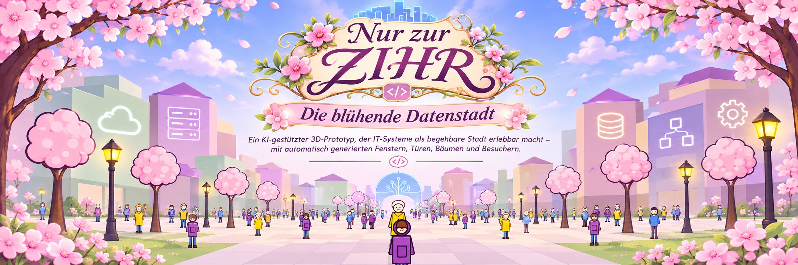
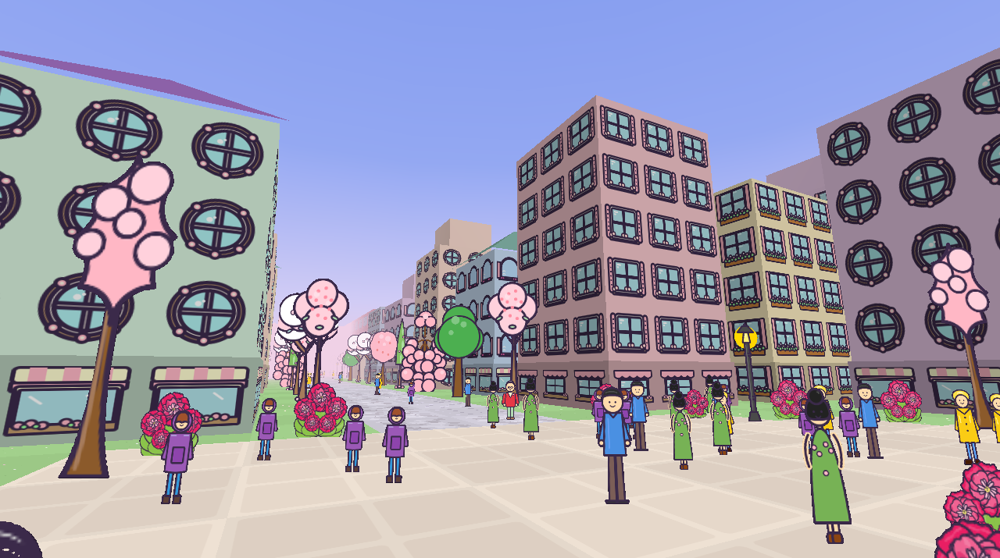
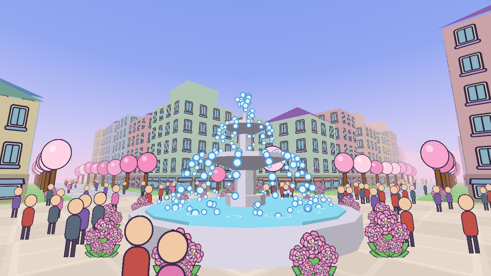
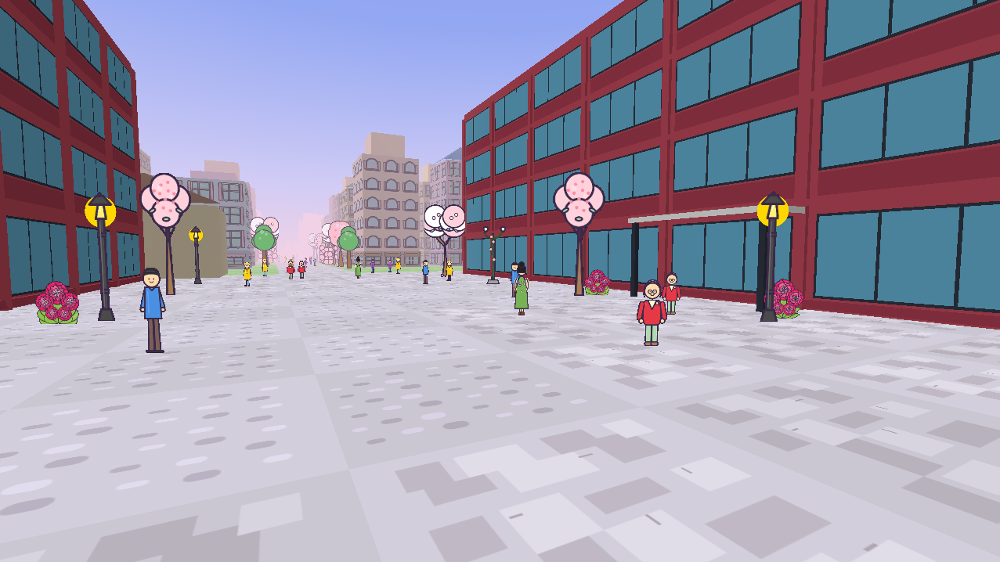

**Eine begehbare, blühende Datenstadt – und gleichzeitig ein Experiment mit einer selbst geschriebenen Java-3D-Engine (3d4j) und KI-generierten Spielgrafiken.**

> **Projektstatus:** Experimenteller Prototyp. Engine und begehbare Stadt sind im Repository enthalten. Ein Chatmodell zeichnet im Hintergrund laufend neue Varianten von Bäumen, Besuchern, Laternen, Büschen, Bodentexturen, Fenstern, Türen und Läden; sie erscheinen im laufenden Spiel.

| | | |
|---|---|---|
|  |  |  |
| Blütenviertel: Fenster, Läden, Bäume und Besucher hat das Chatmodell gezeichnet | Der Brunnen auf dem Platz | Osterei am Ende der Straße: WEST.SIDE |

## Die Idee: IT-Systeme als Stadt erleben

„Nur zur ZIHR“ verbindet eine verspielte, pastellfarbene Stadt mit einem technischen Experiment: Was wäre, wenn sich IT-Strukturen nicht nur in Diagrammen beschreiben, sondern als begehbare Welt betrachten ließen?

Die Häuser bilden die Kulisse, Bäume und Laternen machen die Straßen lebendig, und kleine Besucher bevölkern den Platz. Langfristig soll die Stadt als anschauliche Metapher für Software- und Datenlandschaften dienen. Der aktuelle Stand ist bewusst ein **Prototyp**, keine fertige Fachvisualisierung oder ein vollständiges Spiel.

Das zweite Experiment läuft gewissermaßen hinter den Kulissen: **Die Grafiken werden nicht alle von Hand gezeichnet.** Ein Chatmodell erhält eine Beschreibung des gewünschten Objekts und zeichnet es als SVG. Die Anwendung prüft und speichert die Ergebnisse, rastert sie bei Bedarf und verwendet sie anschließend in der 3D-Szene. So entsteht schrittweise eine wiederverwendbare Bibliothek mit Bäumen, Personen, Laternen und – im laufenden Ausbau – unterschiedlichen Fenster- und Türformen. Ziel ist eine vielfältige Welt, die ohne manuelles Zeichnen jedes einzelnen Details wachsen kann.

### Was man heute ausprobieren kann

- **Durch die Stadt laufen:** Platz mit Brunnen, Straßen, Häuser, Bäume, Laternen und Besucher mit einer frei beweglichen Kamera erkunden; Häuser, Brunnen und Bäume sind fest.
- **Grafiken austauschen:** Eigene SVG- oder PNG-Dateien in die Sammlung des Stadtteils legen; im Pausenmenü lassen sich Bilder ansehen und löschen.
- **Motive per KI generieren:** Das Spiel an eine OpenAI-kompatible Chat-API anbinden (Zugang auch aus KeePass); es zeichnet im Hintergrund neue Motive, während man spielt.
- **Den Renderer untersuchen:** Bildrate, Framezeiten, Auflösung und Backend vergleichen – auch auf Rechnern ohne dedizierten Grafiktreiber.

### So funktioniert die Grafik-Pipeline

```text
Objektbeschreibung
       |
       v
Chatmodell (OpenAI-kompatible API)
       |
       v
SVG-Antwort -- Validierung / ggf. erneuter Versuch
       |
       v
Sammlung des Stadtteils (SVG + PNG)
       |
       v
Sprite-Atlas / Szene --> 3D-Renderer --> begehbare Datenstadt
```

Die KI ist **für das Erzeugen der Assets** zuständig; das eigentliche Anzeigen und Begehen der Stadt läuft lokal. Vorhandene Bilder bleiben in der Sammlung und werden wiederverwendet; gezeichnet wird nur, bis die Höchstzahl je Art erreicht ist. Wie gut die Ergebnisse aussehen, hängt auch vom gewählten Modell und den Beschreibungen der Objekte ab.

## Die Engine hinter der Stadt

Grundgerüst für eine 3D-Engine in reinem Java 21. Alles ist in Java geschrieben, auch die
eingebundenen Bibliotheken; nativen Code bringt das Projekt nicht mit. Fenster, Eingabe und
Grafik werden über die Foreign Function & Memory API (FFM) direkt aus den Systembibliotheken
angesprochen:

| Plattform | Fenster und Eingabe | Grafik |
|---|---|---|
| Windows x64 | `user32.dll` | Direct3D 11 (`d3d11.dll`, `d3dcompiler_47.dll`), ersatzweise OpenGL 3.3 über WGL |
| Linux x64 | Xlib (`libX11.so.6`) | OpenGL 3.3 über GLX (`libGL.so.1`) |

Gerendert wird mit Shadern, Vertex-Buffern und voller Hardwarebeschleunigung. Unter Windows
ist Direct3D 11 der Standard, weil es auch dort läuft, wo kein OpenGL-Treiber vorhanden ist
(Firmenrechner, virtuelle Maschinen, Remote-Sitzungen): Fehlt ein Hardware-Treiber, nutzt
die Engine WARP, den Software-Renderer von Windows.

## Voraussetzungen

- **Genau JDK 21.** Die FFM-API ist dort eine Preview-API, und Preview-Klassen laufen nur
  auf der Java-Version, für die sie kompiliert wurden.
- Windows x64 oder Linux x64 mit X11 (unter Wayland über XWayland).
- Windows: nichts weiter, Direct3D 11 gehört zum System. Linux: ein Treiber mit OpenGL 3.3
  oder neuer.

## Starten

Das fertige JAR baut eine GitHub Action bei jedem Push auf `main` und legt es als festes
Release-Asset ab:

**[3d4j.jar herunterladen](https://github.com/aresstack/3d4j/releases/download/latest/3d4j.jar)**

Starten per Doppelklick oder mit

```
java -jar 3d4j.jar
```

Mehr ist nicht nötig: Das Manifest nennt den `Launcher` als Hauptklasse, und der startet die
JVM selbst noch einmal mit `--enable-preview` (siehe [Der Launcher](#der-launcher)). Das `java`
der Kommandozeile oder des Doppelklicks muss nicht Java 21 sein: Der Launcher läuft ab Java 8
und sucht sich ein installiertes Java 21 selbst.
Bei einem Doppelklick läuft das Programm auf `javaw` ohne Konsole; Fehler wie eine falsche
Java-Version erscheinen dann in einem Dialog.

Gestartet wird „Nur zur ZIHR“: erst das Panoramabild als Ladebildschirm (Leertaste, Enter oder
Mausklick überspringt ihn), dann ein begehbarer Testplatz mit 140 Gebäuden, Bäumen, Laternen
und Besuchern.

| Taste | Wirkung |
|---|---|
| W A S D | Gehen |
| E / Q | Hoch / runter |
| Umschalt | Schneller |
| Maus (im Vollbild), Maustaste halten und ziehen (im Fenster), oder Pfeiltasten | Umsehen |
| Alt+Enter | Vollbild an oder aus |
| 1 bis 5 | Interne Auflösung: 100, 75, 50, 33, 25 Prozent |
| F | Hochskalieren weich oder pixelig |
| R | Framezeit-Statistik zurücksetzen |
| P | `screenshot.png` speichern |
| Esc | Pausenmenü (Weiterspielen, Einstellungen, Spiel beenden) |

Das Spiel startet im **Vollbild**: ein rahmenloses Fenster über den ganzen Bildschirm, ohne
den Bildschirmmodus umzuschalten. Alt+Enter wechselt zum Fenster und zurück; die Wahl wird
gemerkt, `--windowed` startet einmalig im Fenster. Im Vollbild ist die Maus **eingefangen**,
solange gespielt wird: Der Zeiger ist weg, und die Maus sieht sich um, ohne dass eine Taste
gehalten wird. In jedem Menü (Pause, Zugang) ist der Zeiger wieder da, als pinke Pfeilspitze,
deren Enden dünn auslaufen und sich wie ein gezwirbelter Bart nach oben wenden; wechselt man in ein anderes Programm, gibt das Spiel die Maus frei. Im Fenster
wird wie bisher mit gehaltener Maustaste umgesehen, was auch in Remote-Sitzungen und
virtuellen Maschinen zuverlässig funktioniert.

Unter Windows meldet die eingefangene Maus ihre Bewegung selbst (Raw Input, `WM_INPUT`, der
Nachfolger von DirectInput für Mäuse): in ihren eigenen Schritten und unabhängig davon, wo der
Zeiger steht. Der Zeiger wird dabei auf einem Punkt in der Mitte festgehalten, und man kann sich
beliebig oft im Kreis drehen. Die Konsole meldet dann einmal `Mouse: raw input`. Eingefangen
wird nur, solange das Fenster vorn ist; das wird mit jedem Bild bei Windows erfragt. Was das
Einfangen getan hat, steht in `~/.3d4j/mouse.log` (bei jedem Start neu), weil ein per Doppelklick
gestartetes Spiel keine Konsole hat. Eine
Remote-Sitzung, eine virtuelle Maschine oder ein KVM-Gerät meldet statt Bewegung Positionen
(absolute Maus). Dort setzt die Quelle den Zeiger immer wieder an ihre Stelle, Zurücksetzen hilft
nicht: Die Sicht folgt der Zeigerposition und dreht weiter, solange der Zeiger an einem Rand
anliegt. Richtig gut wird es erst, wenn die Quelle auf relative Mausbewegung umgestellt wird.
Unter X11 und wo es kein Raw Input gibt, gilt das Folgende.

Sonst misst `RelativeMouse` die eingefangene Maus: Bewegung zählt immer von der vorigen Position aus,
und der Zeiger wird nur in die Mitte zurückgesetzt, wenn er sich weit entfernt hat. Das
Zurücksetzen wirkt verzögert, vor allem in einer Remote-Sitzung; Positionen von vor dem Sprung,
die danach noch eintreffen, werden daran erkannt, dass sie weit weg von der Mitte und von der
letzten Position liegen, und ausgelassen.

### Messen

Die Titelzeile zeigt jede Sekunde die interne Auflösung, die Bildrate sowie mittlere Framezeit
und 99. Perzentil. Beim Beenden gibt die Engine die Statistik des ganzen Laufs aus, mit 95. und
99. Perzentil. Für vergleichbare Zahlen gibt es eine feste Kamerafahrt:

```
java -jar 3d4j.jar --benchmark --no-vsync --frames=3000
java -jar 3d4j.jar --benchmark --no-vsync --frames=3000 --scale=0.5
```

Argumente: `--benchmark` (kein Ladebildschirm, feste Kamerafahrt), `--scale=0.5` (interne
Auflösung), `--frames=N` (nach N Frames beenden), `--screenshot=DATEI` (den letzten dieser
Frames speichern), `--time=SEKUNDEN` (Szene an diesem Zeitpunkt einfrieren, für vergleichbare
Bilder), `--view=x,y,z,gier,nick` (mit `--benchmark`: fester Standpunkt statt Rundflug, Winkel
in Grad; z. B. `--view=0,2.2,-100,0,8` vor dem WEST.SIDE-Hof), `--no-title`, `--no-vsync`, `--windowed`.

Der drehende Würfel ist als Minimalbeispiel weiter enthalten:
`java -Dthreed4j.main=com.aresstack.threed4j.demo.CubeDemo -jar 3d4j.jar`.

Beim Start gibt die Engine aus, womit sie rendert, zum Beispiel
`Direct3D 11 (feature level 11_0) | <Name der Grafikkarte> | hardware`. Steht dort
`software rendering on the CPU (WARP)`, ist kein Grafiktreiber nutzbar und die CPU rechnet.
Die Grafik-API lässt sich mit `-Dthreed4j.backend=d3d11` oder `-Dthreed4j.backend=opengl`
erzwingen (Standard `auto`: unter Windows Direct3D 11 und nur bei einem Fehler OpenGL).

## Grafiken: die Sammlungen der Stadtteile

Alles Gezeichnete im Spiel stammt aus einer Sammlung je **Stadtteil** (`District`), der
Bilddatenbank des Spiels: Bäume, Laternen, Büsche, Bodentexturen und die Teile der
Hausfassaden. Die **Besucher** gehören keinem Stadtteil: Sie liegen in einer gemeinsamen
Sammlung der ganzen Stadt (`stadt`) und laufen überall herum. Von jeder Art gibt es mehrere
Bilder. Die Sammlungen liegen als Ordner unter dem Asset-Ordner (`TownLibrary`):

```
.3d4j/assets/library/<stadtteil>/<art>-<nummer>.svg|.png|.json
.3d4j/assets/library/stadt/visitor-<nummer>.svg|.png|.json     (und sea-animal-<nummer>)
```

Zwei Stadtteile bringt das Spiel mit; `District.at(x, z)` zieht ihre Grenze:

| Stadtteil | Ordner | Was die Arten dort sind |
|---|---|---|
| **Blütenviertel** um den Startplatz | `bluetenviertel` | Kirschbäume, Parkbäume, Laterne, Pfingstrosen, Rasen, Pflaster, Fenster, Türen, Läden |
| **Werksviertel** um das WEST.SIDE-Ensemble, ein altes Industriegebiet | `werksviertel` | Birken, Bäume, Werkslaterne, Wildwuchs, Schotter, Werkspflaster, Werksfenster, Werkstüren, Tore |

### Mitgelieferte Bilder

Das Spiel bringt Bilder mit, die Modelle in früheren Läufen gezeichnet haben: die Besucher,
die Sammlungen von Blütenviertel und Werksviertel und drei geplante Viertel als `district.json`
(von Hand geschrieben oder überarbeitet, in derselben Form, in der das Modell plant):

| Viertel | Lage | Wahrzeichen |
|---|---|---|
| **Wellenviertel** | östlich vom Startplatz, am Meer | Leuchtturm auf der Landzunge |
| **Alpenviertel** | westlich vom Startplatz, vor den Bergen | Kirche mit Zwiebelturm und Maibaum |
| **Hauptstadtviertel** | nördlich vom Startplatz, dem Werksviertel gegenüber | Fernsehturm |

Die vier liegen rings um das Blütenviertel. Die Karte ist ein Scherz auf Deutschland: das
WEST.SIDE-Ensemble als Bonn, der Leuchtturm als Küste, gegenüber die Alpen, und Bonn gegenüber
der Fernsehturm als Berlin. Beim ersten Start kopiert
`DefaultAssets` sie aus dem Programm in den Asset-Ordner (`src/main/resources/defaults`).
Jede Datei wird genau einmal angeboten (`library/.defaults` merkt sich, welche): Vorhandenes
bleibt unberührt, und ein gelöschtes Bild kommt nicht wieder. Abschalten mit
`-Dthreed4j.defaults=false`.

### Das Meer

Östlich der Stadt liegt das Meer. Die Küste (`District.coastX`) ist eine geschwungene Linie:
In der Mitte jedes Feldes der ersten Spalte im Osten ragt eine Landzunge vor, dazwischen liegen
Buchten; der Leuchtturm des Wellenviertels steht auf der Spitze der ersten. Viertel in dieser
Spalte liegen am Meer: An ihrem Ufer läuft eine Promenade mit Laternen entlang, Häuser, Bäume
und Besucher stehen nur an Land, und weiter östlich wird nichts mehr geplant. Der Planer
erfährt in der Frage nach dem Thema, dass das Viertel am Wasser liegt. Zu Fuß bleibt man an
Land; drüber fliegen geht.

Im Wasser schwimmen **Meerestiere** in Kreisen vor dem Ufer, der untere Teil unter Wasser. Sie
sind wie die Besucher eine Art der ganzen Stadt (`sea-animal` in `library/stadt`, Vorgabe 12)
und werden im Hintergrund gezeichnet: Delfin, Robbe, Schwan, Wal, Schildkröte, Krake, Möwe,
Ente, Krebs, Pelikan, Segelboot, Boje. Bis das erste Bild da ist, schwimmt eine Ente.
Ringe auf dem Wasser zeichnet der Shader des Brunnenwassers.

### Die Berge

Westlich der Stadt stehen die Alpen (`Alps`): eine Reihe grüner Vorberge und hoher Gipfel mit
Schnee, gleich hinter der ersten Spalte von Feldern im Westen. Wie am Meer im Osten wird
dahinter nichts mehr geplant; die Stadt wächst nach Norden und Süden.

### Tiere auf den Straßen

Jedes Viertel hat eigene Tiere (Art `animal`, Vorgabe 8 Bilder), die wie die Besucher über
Platz und Straßen laufen: im Blütenviertel Katze, Hund, Taube, Eichhörnchen, Hase; im
Werksviertel Streunerkatze, Krähe, Fuchs, Igel; im Alpenviertel Kuh mit Glocke, Ziege, Dackel,
Huhn, Murmeltier, Gams, Bernhardiner; im Hauptstadtviertel Bär, Fuchs, Taube, Frischling,
Waschbär. Der Planer legt sie für neue Viertel mit fest. Welches Bild ein Tier zeigt, wählt es
wie alles andere selbst; alle Tiere sind gleich groß.

### Die Stadt wächst: geplante Viertel

Weitere Viertel plant ein Modell selbst (`DistrictPlanner`), von oben nach unten wie ein
Stadtplaner und Architekt. Jeder Schritt ist eine Frage mit einer kleinen JSON-Antwort, die das
Spiel prüft und bei Fehlern mit Begründung noch einmal stellt:

1. **Thema:** Name, Stil, Farbpalette (Wände, Dächer, Boden), Maße und Dachformen der Häuser,
   Idee für das Wahrzeichen. Die vorhandenen Viertel stehen in der Frage, damit das neue anders wird.
2. **Motive:** was Baum, Laterne, Fenster, Tür, Laden usw. in diesem Viertel sind, mit Varianten.
   Danach zeichnet das Zeichnen im Hintergrund sie wie in jedem Viertel.
3. **Wahrzeichen als Bauplan:** zwei bis sieben Bauteile vom Boden nach oben, je mit Lage, Maßen
   und Farbe.
4. **Jedes Bauteil einzeln:** sein Umriss als wenige Punkte.

Das Modell liefert nie 3D-Geometrie. Ein Bauteil ist eine flache Zeichnung plus Regel
(`Landmarks`): **gedreht** (`lathe`: der halbe Umriss von der Seite, um die Achse gedreht –
Schaft, Tank, Kuppel, Scheibe) oder **hochgezogen** (`extrude`: der Umriss von oben, auf Höhe
gezogen, wahlweise mit spitzem Dach). Misslingt ein Umriss dreimal, steht dort ein schlichter
Zylinder oder Quader.

Ein geplantes Viertel ist ein Ordner `library/<id>` mit `district.json` (lesbar und von Hand
änderbar) und seiner Sammlung. Es belegt ein Feld von 200 × 200 m neben den vorhandenen
(`District.plotOrder`); zwei Straßen kreuzen sich in seiner Mitte und laufen in die
Nachbarfelder weiter, das Wahrzeichen steht auf dem Platz an der Kreuzung, die Häuser in einem
Raster dazwischen (`DistrictScene`). Jedes geplante Viertel ist ein eigenes Stück Welt mit
eigenen Texturen: Gezeichnet wird es nur, wenn es näher ist, als der Dunst reicht, und neu
gebaut nur das Viertel, dessen Plan oder Bilder sich geändert haben.

`TownPlanner` plant im Hintergrund das nächste Viertel, sobald das jüngste alle Bilder seiner
Sammlung hat, bis zur eingestellten Höchstzahl (Vorgabe 10 Viertel, die fünf mitgelieferten
eingerechnet). Einstellungen in `.3d4j/generator.properties`: `world.enabled`, `world.model`
(Vorgabe `openai/gpt-oss-120b`), `world.maxDistricts`.

**Stadtverwaltung** (Pausenmenü → Einstellungen → Welt → „Stadtverwaltung …“): die Liste der
Viertel mit Wahrzeichen und Stand der Sammlung. „Neues Viertel planen“ plant sofort eines.
Bei geplanten Vierteln: „Wahrzeichen neu“ lässt ein anderes Wahrzeichen ausdenken und bauen,
„Abreißen“ (mit Nachfrage) verschiebt das Viertel samt Bildern in den Ordner `demolished`
und gibt sein Feld frei. Dort stehen auch An/Aus für das Wachsen, die Höchstzahl und das Modell
für die Planung.

Beide mitgelieferten Viertel sammeln dieselben Arten (Dateinamen wie unten), aber jede Art bedeutet im Stadtteil
etwas Eigenes: Der Auftrag an das Modell nennt das Motiv des Stadtteils (`District.Motif`) und
dessen Stil. Besucher, die ältere Versionen im Ordner des Blütenviertels abgelegt haben, zieht
das Spiel beim Start in die gemeinsame Sammlung um.

Arten: `blossom-tree`, `green-tree`, `lamp`, `visitor`, `bush`, `lawn`, `street`, `window`,
`door`, `shop`. Die JSON-Datei nennt Modell, Zeitpunkt und Auftrag. Der Asset-Ordner ist
`.3d4j/assets` im Benutzerverzeichnis (unter Windows `%USERPROFILE%\.3d4j\assets`), änderbar
mit `-Dthreed4j.assets=ORDNER`.

- **Sofort spielen:** Das Spiel wartet auf nichts. Solange die Sammlung von einer Art kein Bild
  hat, steht ein eingebautes dafür; alle Bäume, Leute und Häuser sehen dann gleich aus.
- **Im Hintergrund:** Beim Spielen zeichnet `BackgroundArtist` auf einem eigenen Thread ein Bild
  nach dem anderen, immer von der Art, die am weitesten von ihrer Höchstzahl entfernt ist. Jede
  Anfrage enthält den Stil des Stadtteils und eine Variante aus einer festen Liste (anderer
  Baumwuchs, andere Kleidung, Rundbogenfenster …), damit die Bilder zusammenpassen und sich
  trotzdem unterscheiden. Den Zugang nimmt er aus dem Zugangsmenü dieses Programmlaufs, sonst
  holt er den gemerkten ohne Nachfrage (KeePass-Eintrag oder Umgebungsvariable). Ohne Zugang
  wartet er.
- **Höchstzahl je Art:** Vorgabe 10 Kirschbäume, 6 Parkbäume, 1 Laterne, 50 Besucher, 6 Büsche,
  je 3 Rasen- und Pflasterkacheln, 8 Fenster, 4 Türen, 4 Läden; je Stadtteil änderbar (0 bis 99),
  gespeichert in `limits.properties` im Ordner der Sammlung.
- **Modell je Art:** In der Sammlung steht oben neben dem Namen der Art, welches Modell sie
  zeichnet; ein Klick öffnet die Liste der Modelle des Dienstes. Ohne eigene Wahl zeichnet das
  allgemeine Modell (Vorgabe `google/gemma-4-31B-it`). Gespeichert als `chat.model.<art>` in
  `.3d4j/generator.properties`, z. B. `chat.model.visitor`.
- **Eine Laterne je Stadtteil:** In einem Stadtteil stehen überall dieselben Laternen. Die
  Sammlung darf mehrere enthalten; in Gebrauch ist die älteste, bis man im Pausenmenü unter
  „Sammlung ansehen“ bei einer anderen „Verwenden“ wählt (`lamp.chosen` in `limits.properties`).
- **Zuweisung:** Jeder Baum, jeder Besucher, jedes Haus und jedes Stück Boden bewertet jedes Bild
  seiner Art mit einer Zahl, die nur von ihm und dem Bild abhängt, und nimmt das höchstbewertete.
  Kommt ein Bild dazu, übernimmt es seinen Anteil, alles Übrige bleibt, wie es war; dieselbe
  Sammlung ergibt immer dieselbe Stadt. Das Spiel bemerkt Änderungen innerhalb einer Sekunde und
  baut die Szene mit dem neuen Stand.
- **Nichts wird überschrieben:** Neue Bilder kommen dazu. Entfernen kann man ein Bild nur von
  Hand, in der Sammlung im Pausenmenü; seine Dateien wandern dann nach `deleted/`.
- **Von Hand:** Ein Bild oder SVG, das man unter passendem Namen in den Ordner legt, zählt
  genauso (ein SVG rechnet das Spiel mit Apache Batik in ein PNG um). Einzelne Dateien direkt im
  Asset-Ordner (`blossom-tree.svg`, `lamp.png` … von früheren Fassungen oder von `generate`)
  übernimmt das Spiel beim Start in die Sammlung, samt `history/`, und legt sie nach `imported/`.

### Das Zugangsmenü

Beim ersten Start, solange kein Zugang zur KI bekannt und noch nichts gesammelt ist, öffnet sich
nach dem Ladebildschirm ein Menü im Stil des Spiels (später: Pausenmenü, Einstellungen, Reiter
„Welt“, „KI-Zugang …“). Es hat zwei Schritte, nach dem Vorbild der Einrichtungsassistenten von
Space Harvester und Enterprise AI Client:

1. **Zugang:** oben wählt man **KeePass**, **Manuell** oder **Ollama**.
   - *KeePass* (vorgewählt): „Koppeln“ verbindet das Spiel mit KeePass. KeePass zeigt ein
     Einmal-Passwort, das man im Menü eintippt; das ist nur beim ersten Mal nötig. Dann wählt man
     in der Auswahlliste den Eintrag des KI-Dienstes. Die **URL des Eintrags ist die Adresse der
     API** (`https://…/v1`), sein **Passwort der API-Key**. Tippen sucht in der Liste, die
     Pfeiltasten blättern.
   - *Manuell:* Adresse und API-Key eintippen. Der Key wird nicht gespeichert.
   - *Ollama:* die Adresse des Ollama-Servers, vorbelegt mit `http://localhost:11434`. Kein
     API-Key. Damit zeichnet ein Modell auf dem eigenen Rechner oder im eigenen Netz, etwa auf der
     eigenen Grafikkarte. Das Spiel spricht Ollamas eigene API, wie AskAI über ollama4j:
     `GET /api/tags` für die installierten Modelle, `POST /api/chat` für eine Frage, die
     Antwortlänge als `options.num_predict`, Nachdenken als `think`. Gemerkt wird
     `chat.provider=ollama` mit der Adresse; beim nächsten Start geht es ohne Nachfrage weiter.
2. **Modell:** Das Menü lädt die Modelle des Dienstes und wählt `google/gemma-4-31B-it` vor, falls
   angeboten. „Weiter“ startet das Spiel; gezeichnet wird ab dann im Hintergrund.

Die Schritte oben sind anklickbar, sobald sie möglich sind. „Ohne KI spielen“ verlässt das Menü
jederzeit; das Spiel läuft dann mit den eingebauten Bildern. `--setup` öffnet das Menü beim
Start in jedem Fall, `--no-setup` nie. Bedient wird es mit der Maus; Tab wechselt das Feld, Enter
löst den rechten Knopf aus, Strg+V fügt ein.

### Wie die Bilder entstehen

- **Figuren** (Bäume, Laternen, Besucher): eine Zeichnung als SVG, hochkant 1:2, freigestellt.
- **Bodenkacheln** (Rasen, Pflaster): quadratisch, von oben; ein Rechteck in der Grundfarbe über
  das ganze Quadrat, darauf kleine Formen mit Abstand zu allen Rändern, damit sich die Kachel
  nahtlos wiederholt. Geprüft wird volle Deckung und ein einfarbiger Rand.
- **Pfingstrosenbusch:** aus Bauplan und Bauteilen (`FlowerComposer`). Das Modell liefert einen
  Bauplan als JSON (Blütenblätter je Ring, Größe, Versatz, Farben) und fünf kleine Bauteile als
  SVG-Fragment, alle gleichzeitig. Java zieht Zahlen in ihren Bereich, baut jedes Bauteil neu auf
  (nur Geometrie und Füllfarben werden übernommen; Farbe aus dem Plan, Schattierung an der
  Silhouette abgeschnitten, Kontur obendrauf) und montiert Blüten und Busch mit `<defs>`/`<use>`.
- **Fassadenteile** (Fenster, Türen, Läden): kleine Bilder mit durchsichtigem Rand, in dem die
  Hauswand sichtbar bleibt; Türen und Läden dürfen auf der Unterkante stehen.

Unbrauchbare Antworten werden mit Begründung neu angefragt, bis zu dreimal.

### Im Renderer

- **Figuren:** ein Atlas mit allen Bildern der Sammlung, ein Netz, ein Draw Call.
- **Boden:** eigenes Netz mit eigenem Shader. Die Texturkoordinate ergibt sich aus der Position
  in der Welt (eine Kachel je 4 m); benachbarte Flächen teilen sich eine Kachel. Weil Texturen
  noch keine Mipmaps haben, blendet der Shader das Muster zwischen 30 und 75 m in die
  Durchschnittsfarbe der Kachel über.
- **Hauswände:** eigenes Netz. Eine Wand ist ein einziges Rechteck; der Shader wiederholt das
  Fassadenteil entlang der Wand und zeigt die Wandfarbe, wo das Bild durchsichtig ist. Ein Haus
  kostet so ein Dutzend Rechtecke, egal wie viele Fenster es hat, und kein Pixel wird doppelt
  gezeichnet. Fensterabstand, Geschosshöhe, Läden ja oder nein und die Seite der Tür sind
  Eigenschaften des Hauses.

Zusammen mit Stadt und Himmel sind das fünf Draw Calls.

### Easter Egg: WEST.SIDE

Vom Start geradeaus die Straße hinunter, hinter den letzten Häusern, steht das Büroensemble
WEST.SIDE aus Bonn: Gebäude B (Generalzolldirektion) links, Gebäude A (Ministerium) rechts,
dahinter das Parkhaus; die Straße führt in den Hof. Es taucht erst beim Hinlaufen aus dem
Dunst auf.

Darum herum liegt das **Werksviertel**, ein altes Industriegebiet im Umbau: Die Straße führt
durch das alte Werkstor und über ein Gleisstück hinein. Backsteinhallen mit Flach- oder
Sheddach, niedriger und breiter als die Häuser des Blütenviertels, stehen, wo das Ensemble
Platz lässt; Schornstein, Wasserturm und Gasometer ragen darüber. Schotter statt Rasen,
Birken und Wildwuchs statt Kirschbäumen und Pfingstrosen.

Maße und Aufbau stammen aus dem Skizzenmodell (`generate_assets.py`: 62 m lang, 18 m tief,
vier Geschosse, Stützenraster 6,9 m, Parkhaus 20 × 64 m). Dessen GLB-Dateien lädt das Spiel
nicht: Sie haben rund 23.000 texturierte Dreiecke, das Dreifache der ganzen Stadt, und die
Engine kann noch keine Modelldateien laden. `WestSide` baut dasselbe Gebäude aus etwa 3.000
einfarbigen Dreiecken nach, im Stil der übrigen Stadt: das rote Raster aus Stützen und Riegeln
als Quader, jedes Fenster als dunkler Rahmen mit Scheibe davor.

### Das Pausenmenü

Esc hält das Spiel an, legt einen Schleier darüber und zeigt eine Karte im Stil des Menüs: **Weiterspielen**,
**Einstellungen**, **Spiel beenden**. Bedient wird sie mit der Maus oder mit Pfeiltasten und
Enter; Esc führt eine Ebene zurück bzw. ins Spiel.

Die Einstellungen haben vier Reiter; alles, was sich im Spiel einstellen lässt, gehört dorthin:

- **Bild:** Auflösung (100 bis 25 %, wie die Tasten 1 bis 5), Hochskalieren (weich oder
  pixelig, wie F), Anzeige (Vollbild oder Fenster, wie Alt+Enter) und, bei mehreren
  Bildschirmen, auf welchem das Spiel läuft (von links nach rechts nummeriert; gemerkt als
  `window.monitor`).
- **Steuerung:** Geschwindigkeit der Maus beim Umsehen, als Schieberegler von 0,10 bis 3,00
  mit einem Zahlenfeld daneben (anklicken, tippen, Enter); 1,00 ist die Vorgabe. Dazu „Umsehen im
  Vollbild“: Maus bewegen oder Maustaste halten (`mouse.hold`). Das Halten ist für Rechner
  gedacht, deren Maus Positionen meldet (virtuelle Maschine): Loslassen und neu Greifen dreht
  von dort weiter, wo der Zeiger gerade steht.
- **KI:** „Nachdenken vor dem Zeichnen“ (Standard, wenig, mittel, viel) wird als
  `reasoning_effort` gesendet, bei „Standard“ gar nicht, wie im Enterprise AI Client.
  „Antwortlänge in Tokens“ ist `max_tokens`; Nachdenken zählt mit.
- **Welt:** „Im Hintergrund weiterzeichnen“ an oder aus, mit dem Stand. „Sammlung ansehen …“
  zeigt die Bilder des Stadtteils, in dem man steht; über den Namen oben wechselt man zum anderen
  Stadtteil oder zu „Ganze Stadt“ (die Besucher). Links die Arten mit Anzahl und Höchstzahl, rechts die Bilder
  der gewählten Art mit Nummer und Modell. „Löschen“ nimmt ein Bild heraus, „–“ und „+“ ändern
  die Höchstzahl. „KI-Zugang …“ öffnet das Zugangsmenü.

Bild und Steuerung merkt sich das Spiel in `.3d4j/game.properties` (`--scale=` hat Vorrang,
`--benchmark` ignoriert die Datei), die KI-Werte in `.3d4j/generator.properties`
(`chat.reasoningEffort`, `chat.maxTokens`, `background.enabled`), wo sie auch für `generate` gelten. Das Modell wählt
man im Zugangsmenü.

Dafür mischt der Renderer im Overlay (nach dem Hochskalieren der Szene) durchsichtige Pixel
mit dem, was darunter liegt, in OpenGL wie in Direct3D 11. Die Szene selbst bleibt deckend
gezeichnet; im laufenden Spiel kostet das nichts.

### Der Generator auf der Kommandozeile

Einzelne Bilder ohne Spiel:

```
java -jar 3d4j.jar generate
```

Er fragt je ein Bild der Figuren, des Busches und der Bodenkacheln an (mehrere Anfragen
gleichzeitig) und legt SVG, PNG und JSON direkt im Asset-Ordner ab; das Spiel übernimmt sie
beim nächsten Start in die Sammlung. Für das laufende Auffüllen der Sammlung ist das Spiel
selbst zuständig. Die folgenden Einstellungen gelten für beide.

- **Dienst und Modell:** eine OpenAI-kompatible API (`POST <Basis-URL>/chat/completions`).
  Der Generator verwendet, was im Menü gewählt wurde (`.3d4j/generator.properties`), sonst die
  Konfiguration des Enterprise AI Client (`chat.baseUrl`, `chat.model`, `chat.apiKeyRef`).
  Oder einmal angeben, die Werte werden gemerkt: `--entry=TITEL --model=google/gemma-4-31B-it`.
- **Adresse und API-Key:** aus dem KeePass-Eintrag über das KeePassRPC-Plugin:
  Passwort = API-Key, URL = Adresse. `--base-url=https://.../v1` hat
  Vorrang vor der URL des Eintrags. Beim ersten Lauf zeigt KeePass einen Kopplungscode, den
  man in die Konsole tippt; die Kopplung liegt danach in `.3d4j/keepass.properties` und gilt
  auch für das Menü. Ist die Umgebungsvariable `THREED4J_API_KEY` gesetzt, wird sie statt
  KeePass verwendet; dann muss die Adresse angegeben sein.
- **Antwortlänge:** Jede Anfrage sendet `max_tokens` (Standard 8192, sonst `chat.maxTokens` aus
  `.3d4j/generator.properties` oder dem Enterprise AI Client). Meldet der Dienst
  `finish_reason=length`, gilt die Antwort als abgeschnitten und wird nicht verwendet.
- **Weitere Argumente:** `--parallel=N` (Standard 4), `--only=lamp,visitor-1`, `--force`
  (auch zeichnen, was im Asset-Ordner schon liegt).
- **Proxy:** Den Weg zum Dienst bestimmt `win-proxy-java`, wie im Enterprise AI Client und in
  Space Harvester. Gelesen wird `network.proxy.*` aus der Konfiguration des Enterprise AI
  Client (Modus, PAC-URL, Host, Port, `nonProxyHosts`, BASIC-Anmeldung aus KeePass); dieselben
  Schlüssel in `.3d4j/generator.properties` haben Vorrang, davor
  `-Dthreed4j.proxy.mode=… -Dthreed4j.proxy.pacUrl=… -Dthreed4j.proxy.host=… -Dthreed4j.proxy.port=…`.
  Ohne Einstellung gilt unter Windows `PAC_URL_POWERSHELL` (PAC-Skript der Windows-Einstellungen),
  sonst `DISABLED`. `java -jar 3d4j.jar generate --route=https://dienst/` zeigt Schritt für
  Schritt, welcher Weg für eine Adresse herauskommt. Menü und Generator verwenden denselben Weg.
- **Zertifikate:** Unter Windows gelten Javas eigene Liste und zusätzlich die Stammzertifikate
  des Windows-Speichers, damit firmeneigene Zertifikate (Dienst oder prüfender Proxy) akzeptiert
  werden.

Abgelehnte Antworten des Modells landen zur Ansicht als `<name>.rejected.txt` im Asset-Ordner.

Wird ein Bild mit `generate` neu gezeichnet, wandert das bisherige vorher nach
`history/<name>/`; auch das übernimmt das Spiel.

## Der Launcher

`java -jar` startet die JVM ohne `--enable-preview`, die Engine braucht das Flag aber, und zwar
auf genau Java 21. Ein Rechner öffnet JARs aber oft mit einem anderen Java. `Launcher` löst
beides:

1. Er ist **für Java 8 und ohne** Preview kompiliert (eigenes Source-Set `src/launcher/java`)
   und kennt die Engine nur dem Namen nach. Das geht in einem einzigen JAR: Jede Klassendatei
   trägt ihre eigene Version, und eine JVM stört sich nur an Klassen, die sie tatsächlich lädt.
   Entpackt wird nichts, das zweite Java bekommt dasselbe JAR als Klassenpfad.
2. Läuft er nicht auf Java 21, sucht `JavaRuntimeFinder` ein Java 21 und startet es mit den
   Flags. Gesucht wird in dieser Reihenfolge, der erste Treffer zählt: `-Dthreed4j.java` oder
   die Umgebungsvariable `THREED4J_JAVA` (Ordner oder `java`-Datei), `JAVA_HOME`, jedes `java`
   im `PATH` (das, was `where.exe java` auflistet), dann die üblichen Installationsordner
   (unter Windows `Program Files` mit Eclipse Adoptium, Microsoft, Zulu, Corretto, BellSoft,
   JetBrains und anderen, `~/.jdks`, Scoop; sonst `/usr/lib/jvm`, SDKMAN,
   `/Library/Java/JavaVirtualMachines`). Die Version nennt die Datei `release` der Installation;
   passt sie oder fehlt sie, wird das Java mit `-XshowSettings:properties -version` gefragt
   (höchstens zehn Sekunden). Der Fund steht danach in `~/.3d4j/launcher.properties` und wird
   beim nächsten Start nur noch geprüft. Die Suche stammt aus dem Enterprise AI Client (dort
   bis 0.1.43 für den Sidecar), mit dem Unterschied, dass nur genau Java 21 zählt. Findet sich
   keins, sagt das eine Meldung, bei einem Doppelklick als Dialog.
3. Auf Java 21 versucht er, die Engine-Klasse `ffm.Native` zu laden. Scheitert das mit
   `UnsupportedClassVersionError`, ist Preview nicht aktiv.
4. Dann startet er dieselbe JVM erneut mit `--enable-preview --enable-native-access=ALL-UNNAMED`,
   reicht alle JVM-Optionen und Argumente durch und gibt den Exit-Code des Kindprozesses zurück.

Zwei Details dazu:

- javac markiert nur die Klassen als Preview, die selbst eine Preview-API benutzen. Die
  Hauptklasse eines Spiels tut das meist nicht, deshalb prüft der Launcher eine feste
  Engine-Klasse statt der Hauptklasse.
- Ein Debug-Agent (`-agentlib:jdwp`) wird nicht an den zweiten Prozess weitergereicht, weil
  dieser sonst denselben Port belegen wollte.
- An ein anderes Java gehen nur die System-Properties (`-D...`) weiter: Optionen von Java 8
  kennt Java 21 zum Teil nicht mehr.
- Läuft der Launcher ohne Konsole (Doppelklick), nimmt er auch vom gefundenen Java `javaw.exe`,
  damit kein Konsolenfenster aufgeht.

Welche Klasse gestartet wird, bestimmt die System-Property `threed4j.main`
(Standard: `com.aresstack.threed4j.demo.PlazaDemo`):

```
java -Dthreed4j.main=mein.spiel.Main -jar build/libs/3d4j.jar
```

## Entwickeln und Debuggen

Lokal bauen: `./gradlew jar` (unter Windows `gradlew.bat jar`), das JAR liegt danach unter
`build/libs/3d4j.jar`.

`./gradlew run` startet die Demo direkt mit den Preview-Flags, ohne zweiten Prozess.
In der IDE entsprechend: Hauptklasse `CubeDemo`, VM-Optionen

```
--enable-preview --enable-native-access=ALL-UNNAMED
```

`./gradlew runJar` startet dagegen über den Launcher, so wie `java -jar`.

## Aufbau

Alles liegt unter `com.aresstack.threed4j`:

| Paket | Inhalt |
|---|---|
| `launcher` | Sucht Java 21 und startet es mit `--enable-preview` (eigenes Source-Set, für Java 8 und ohne Preview kompiliert) |
| `ffm` | `Native`: Hilfsschicht über der FFM-API (Bibliotheken laden, Strings, Speicher) |
| `gl` | `GL`: handgeschriebene OpenGL-Bindings; `GLLoader`: Auflösung der Funktionsadressen |
| `platform` | `Window`, `GLWindow`, `Input`, `Key`, `MouseButton` |
| `platform.win32` | `Win32Api` (Bindings) und `Win32Window` (Fenster, Nachrichten, optional WGL) |
| `platform.x11` | `X11Api` (Bindings) und `X11Window` (Fenster, Events, GLX) |
| `gfx` | Die Grafik-Schnittstelle der Engine: `GraphicsDevice`, `Shader`, `ShaderLayout`, `Mesh`, `Texture`, dazu `MeshBuilder`, `Meshes`, `Textures`, `Camera`, `Screenshot` |
| `gfx.gl` | OpenGL-Implementierung: `GLDevice`, `GLShader`, `GLMesh`, `GLTexture` |
| `gfx.d3d11` | Direct3D-11-Implementierung: `D3D11Api` (Bindings), `ComObject` (COM-Aufrufe), `D3D11Device`, `D3D11Shader`, `D3D11Mesh`, `D3D11Texture` |
| `core` | `Engine` (Game-Loop), `Display` (Auswahl von Fenster und Grafik-API), `Game`, `EngineContext`, `EngineConfig`, `FrameStats` |
| `math` | `Vec3`, `Mat4` |
| `assets` | `AssetStore` (Asset-Ordner), `PartLibrary` (eine Sammlung), `TownLibrary` (alle Sammlungen der Stadt), `District`, `AssetCatalog`, `SvgRasterizer` (SVG zu Bild mit Batik) |
| `generator` | `AiSetup` (Schnittstelle für das Menü), `AssetGenerator`, `FlowerComposer` (Motiv aus Bauplan und Bauteilen), `Artist`, `PartArtist` und `BackgroundArtist` (Bilder für die Sammlung), `ChatClient`, `KeePassApiKey`, `KeePassEntry`, `GeneratorConfig`, `ProxyRoutes` |
| `com.aresstack.enterpriseai…keepassrpc` | KeePassRPC-Anbindung (Kopplung, Einträge), unveränderte Kopie aus dem Enterprise AI Client, wie in Space Harvester; siehe `UPSTREAM.md` dort. Eigene Datei nur `KeePassRpcLink` |
| `demo` | `PlazaDemo` (Ladebildschirm, Menü und Testplatz), `SetupScreen` (das Menü), `PauseMenu`, `GameSettings`, `PlazaScene`, `Facades`, `FacadeAtlas`, `WestSide` (Easter Egg), `GroundAtlas`, `SpriteAtlas`, `CubeDemo` |

Ein Spiel benutzt nur `core`, `gfx`, `math` und `platform`; von OpenGL oder Direct3D sieht es
nichts.

### Ein Frame in zwei Phasen

Die Szene wird in ein Bild in interner Auflösung gerendert (Fenstergröße mal `renderScale`),
mit Tiefentest. `Game.render` zeichnet in dieses Bild. Danach streckt die Engine es auf die
Fenstergröße, und `Game.renderOverlay` zeichnet in voller Auflösung darüber: Ladebildschirm,
Menüs, Anzeigen. So bleibt Schrift scharf, während die Szene mit weniger Pixeln auskommt. Das
ist der wichtigste Hebel, wenn ein Software-Renderer rechnet, denn dort kostet jeder Pixel
CPU-Zeit.

Der Testplatz zeigt die übrigen Sparmaßnahmen: Jede Art von Fläche liegt in einem einzigen
Mesh – Gebäudekörper, Fassaden, Boden, Sprites (Bäume, Laternen, Besucher; das Ausrichten zur
Kamera und die Bewegung rechnet der Vertex-Shader), das Wasser des Brunnens und der Himmel.
Sechs Zeichenaufrufe pro Frame, Beleuchtung in drei festen Stufen, Dunst statt Fernsicht,
Sprites ausgestanzt statt transparent.

Der Brunnen ist ein Schalenbrunnen aus Stein und spuckt Wasser: Die Düse an der Spitze wirft
eine Fontäne in die kleine Schale, die läuft in die große über und diese in das Becken; vom
Beckenrand steigen kleine Strahlen zur Mitte, und wo Wasser auftrifft, laufen Ringe über die
Oberfläche. 

Häuser, Hallen, das WEST.SIDE-Ensemble, das Werkstor, Schornstein, Gasometer, der Brunnen, Baumstämme und Laternen sind fest (`Obstacles`):
Wer dagegenläuft, gleitet an der Wand entlang. Darüber hinwegfliegen geht, und wer von oben
kommt, landet auf dem Dach. Die Besucher drehen ihre Runden außerhalb des Brunnens.

Jeder Tropfen ist ein Viereck mit Startpunkt, Startgeschwindigkeit und Takt;
wo er gerade ist, rechnet der Vertex-Shader (`water`) allein aus der Zeit. Pro Frame fällt
dafür auf der CPU nichts an, und Texturen braucht das Wasser nicht.

### Shader

Jeder Shader liegt unter `src/main/resources/shaders` in beiden Sprachen vor: `name.vert` und
`name.frag` (GLSL) für OpenGL, `name.hlsl` mit den Einstiegspunkten `vertexMain` und
`pixelMain` für Direct3D. Das `ShaderLayout` in Java beschreibt Vertex-Attribute und Uniforms.
Für die HLSL-Datei ist seine Reihenfolge bindend: Attribut `i` hat die Semantik `ATTRIBUTEi`,
und die Uniforms bilden in derselben Reihenfolge einen `cbuffer` an Register `b0`.

Beide Backends verhalten sich gleich: Matrizen folgen den OpenGL-Konventionen von `Mat4`,
Dreiecke gegen den Uhrzeigersinn zeigen zum Betrachter, Rückseiten werden verworfen. Den
anderen Tiefenbereich von Direct3D gleicht eine Zeile im HLSL-Vertex-Shader aus.

### Ein eigenes Spiel

```java
public final class MyGame implements Game {
    public static void main(String[] args) {
        Engine.run(EngineConfig.of("Mein Spiel", 1280, 720), new MyGame());
    }

    @Override public void init(EngineContext context) { /* context.graphics(): Shader und Meshes anlegen */ }
    @Override public void update(EngineContext context, double deltaSeconds) { /* Logik, Eingabe */ }
    @Override public void render(EngineContext context) { /* graphics.clear(...), graphics.draw(mesh, shader) */ }
    @Override public void renderOverlay(EngineContext context) { /* optional: 2D in voller Auflösung */ }
    @Override public void dispose() { /* GPU-Ressourcen freigeben */ }
}
```

### Eine OpenGL-Funktion ergänzen

In `GL` ein Handle mit der C-Signatur und eine statische Wrapper-Methode anlegen, nach dem
Muster der vorhandenen Funktionen. Für Direct3D entsprechend in `D3D11Api`: Dort steht zu
jeder COM-Methode ihre Slot-Nummer in der virtuellen Methodentabelle. `GL` darf erst benutzt werden, wenn ein `Window`
existiert: Die Funktionsadressen liefert unter Windows erst der Grafiktreiber, sobald ein
Kontext aktiv ist.

## Build

`.github/workflows/build.yml` baut das JAR, prüft Manifest und Class-File-Versionen (Launcher
ohne, FFM-Schicht mit Preview-Markierung), startet es auf einem virtuellen Display mit einem
schlichten `java -jar` (einmal den Ladebildschirm, einmal den Testplatz) und veröffentlicht es anschließend unter dem festen Release-Tag `latest`.

## Teststand

| Umgebung | Stand |
|---|---|
| Linux x64, OpenGL (Mesa llvmpipe unter Xvfb) | getestet: Start über den Launcher, Rendering, Tastatur, Größenänderung, Schließen |
| Windows-Codepfad mit Windows-JDK 21 unter Wine, Direct3D 11 | getestet: dieselben Punkte; das Bild ist pixelgleich mit dem OpenGL-Bild |
| Windows-Codepfad unter Wine, OpenGL | getestet: dieselben Punkte |
| Echtes Windows, Direct3D 11 auf WARP („Microsoft Basic Render Driver“) | Würfel-Demo läuft; der Testplatz ist dort noch nicht gelaufen |
| Echtes Windows, Direct3D 11 mit Grafikkartentreiber | noch nicht getestet |
| Echtes Windows ohne OpenGL-Treiber, OpenGL | scheitert erwartungsgemäß mit einer Diagnose („GDI Generic“) |

## Grenzen und nächste Schritte

- Text, Audio, Kollision und das Laden von Modelldateien fehlen noch.
- Menü und Generator sind nur gegen einen nachgebauten Dienst getestet, nicht gegen ein echtes
  KeePass und nicht gegen den echten KI-Dienst. Kopplung und Eintragsliste laufen gegen den
  nachgebauten KeePassRPC-Server des Enterprise AI Client (`FakeKeePassRpcServer`). Der Weg
  über einen Proxy ist mit festem Proxy und mit einer PAC-Datei geprüft, nicht mit den
  Windows-Modi (PowerShell) und nicht mit Anmeldung am Proxy.
- Das Menü ist als ein Bild mit Java 2D gemalt; Textfelder kennen nur Anhängen, Löschen am
  Ende und Einfügen.
- Ohne Dateien im Asset-Ordner sind die Sprites mit Java 2D gemalte Platzhalter (`SpriteAtlas`).
- Texturen haben keine Mipmaps, weit entfernte Sprites flimmern deshalb leicht.
- macOS wird nicht unterstützt (dort wäre Cocoa über `objc_msgSend` nötig).
- Der Game-Loop hat einen variablen Zeitschritt und ohne VSync keine Bildratenbegrenzung.
- Umstieg auf Java 22 oder neuer: Die FFM-API ist dort final. Alle Methoden, die sich
  zwischen Preview und finaler API geändert haben, werden nur in `ffm/Native.java` benutzt.
  Danach können `--enable-preview` und der Neustart im Launcher entfallen.
