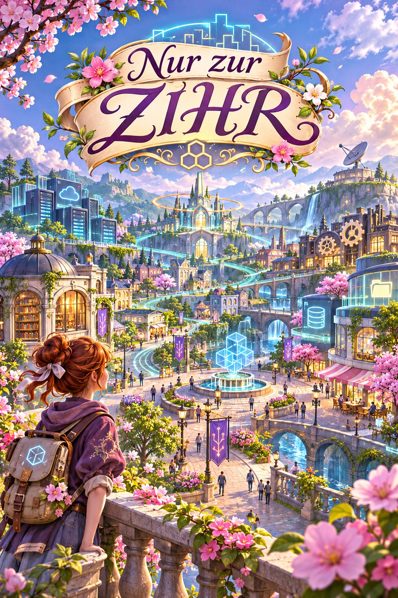

# 3d4j



Grundgerüst für eine 3D-Engine in reinem Java 21. Alles ist in Java geschrieben, auch die
eingebundenen Bibliotheken; nativen Code bringt das Projekt nicht mit. Fenster, Eingabe und
Grafik werden über die Foreign Function & Memory API (FFM) direkt aus den Systembibliotheken
angesprochen:

| Plattform | Fenster und Eingabe | Grafik |
|---|---|---|
| Windows x64 | `user32.dll` | Direct3D 11 (`d3d11.dll`, `d3dcompiler_47.dll`), ersatzweise OpenGL 3.3 über WGL |
| Linux x64 | Xlib (`libX11.so.6`) | OpenGL 3.3 über GLX (`libGL.so.1`) |

Gerendert wird mit Shadern, Vertex-Buffern und voller Hardwarebeschleunigung. Unter Windows
ist Direct3D 11 der Standard, weil es auch dort läuft, wo kein OpenGL-Treiber vorhanden ist
(Firmenrechner, virtuelle Maschinen, Remote-Sitzungen): Fehlt ein Hardware-Treiber, nutzt
die Engine WARP, den Software-Renderer von Windows.

## Voraussetzungen

- **Genau JDK 21.** Die FFM-API ist dort eine Preview-API, und Preview-Klassen laufen nur
  auf der Java-Version, für die sie kompiliert wurden.
- Windows x64 oder Linux x64 mit X11 (unter Wayland über XWayland).
- Windows: nichts weiter, Direct3D 11 gehört zum System. Linux: ein Treiber mit OpenGL 3.3
  oder neuer.

## Starten

Das fertige JAR baut eine GitHub Action bei jedem Push auf `main` und legt es als festes
Release-Asset ab:

**[3d4j.jar herunterladen](https://github.com/aresstack/3d4j/releases/download/latest/3d4j.jar)**

Starten per Doppelklick oder mit

```
java -jar 3d4j.jar
```

Mehr ist nicht nötig: Das Manifest nennt den `Launcher` als Hauptklasse, und der startet die
JVM selbst noch einmal mit `--enable-preview` (siehe [Der Launcher](#der-launcher)).
Bei einem Doppelklick läuft das Programm auf `javaw` ohne Konsole; Fehler wie eine falsche
Java-Version erscheinen dann in einem Dialog.

Gestartet wird „Nur zur ZIHR“: erst das Panoramabild als Ladebildschirm (Leertaste, Enter oder
Mausklick überspringt ihn), dann ein begehbarer Testplatz mit 140 Gebäuden, Bäumen, Laternen
und Besuchern.

| Taste | Wirkung |
|---|---|
| W A S D | Gehen |
| E / Q | Hoch / runter |
| Umschalt | Schneller |
| Maustaste halten und ziehen, oder Pfeiltasten | Umsehen |
| 1 bis 5 | Interne Auflösung: 100, 75, 50, 33, 25 Prozent |
| F | Hochskalieren weich oder pixelig |
| R | Framezeit-Statistik zurücksetzen |
| P | `screenshot.png` speichern |
| Esc | Beenden |

Umgesehen wird mit gehaltener Maustaste statt mit eingefangenem Mauszeiger, weil das auch in
Remote-Sitzungen und virtuellen Maschinen zuverlässig funktioniert.

### Messen

Die Titelzeile zeigt jede Sekunde die interne Auflösung, die Bildrate sowie mittlere Framezeit
und 99. Perzentil. Beim Beenden gibt die Engine die Statistik des ganzen Laufs aus, mit 95. und
99. Perzentil. Für vergleichbare Zahlen gibt es eine feste Kamerafahrt:

```
java -jar 3d4j.jar --benchmark --no-vsync --frames=3000
java -jar 3d4j.jar --benchmark --no-vsync --frames=3000 --scale=0.5
```

Argumente: `--benchmark` (kein Ladebildschirm, feste Kamerafahrt), `--scale=0.5` (interne
Auflösung), `--frames=N` (nach N Frames beenden), `--screenshot=DATEI` (den letzten dieser
Frames speichern), `--time=SEKUNDEN` (Szene an diesem Zeitpunkt einfrieren, für vergleichbare
Bilder), `--no-title`, `--no-vsync`.

Der drehende Würfel ist als Minimalbeispiel weiter enthalten:
`java -Dthreed4j.main=com.aresstack.threed4j.demo.CubeDemo -jar 3d4j.jar`.

Beim Start gibt die Engine aus, womit sie rendert, zum Beispiel
`Direct3D 11 (feature level 11_0) | <Name der Grafikkarte> | hardware`. Steht dort
`software rendering on the CPU (WARP)`, ist kein Grafiktreiber nutzbar und die CPU rechnet.
Die Grafik-API lässt sich mit `-Dthreed4j.backend=d3d11` oder `-Dthreed4j.backend=opengl`
erzwingen (Standard `auto`: unter Windows Direct3D 11 und nur bei einem Fehler OpenGL).

## Grafiken aus Dateien und vom Chatmodell

Bäume, Laternen und Besucher des Testplatzes sind eingebaute Platzhalter. Liegt im
Asset-Ordner eine Datei mit passendem Namen, ersetzt sie den Platzhalter:

| Datei | Motiv |
|---|---|
| `blossom-tree`, `green-tree` | Bäume |
| `lamp` | Laterne |
| `visitor-1`, `visitor-2`, `visitor-3` | Besucher |

Jeweils als `.svg` oder `.png`, hochkant im Verhältnis 1:2 mit transparentem Hintergrund. Der
Ordner ist `.3d4j/assets` im Benutzerverzeichnis (unter Windows `%USERPROFILE%\.3d4j\assets`),
änderbar mit `-Dthreed4j.assets=ORDNER`. Eine SVG-Datei rechnet das Spiel beim Start mit Apache
Batik in ein PNG um. Es genügt also, ein SVG in den Ordner zu legen, auch eines, das man aus
einem Chat kopiert hat. Beim Laden der Szene meldet die Konsole, wie viele Sprites aus dem
Ordner kommen.

### Das Menü „Die Welt erschaffen“

Solange noch keine erzeugten Motive im Asset-Ordner liegen, öffnet sich nach dem Ladebildschirm
ein Menü im Stil des Spiels. Es führt in vier Schritten zur erzeugten Welt, nach dem Vorbild der
Einrichtungsassistenten von Space Harvester und Enterprise AI Client:

1. **KI-Dienst:** Adresse des Dienstes und Titel des KeePass-Eintrags mit dem API-Key. Beides
   ist vorbelegt, wenn der Enterprise AI Client auf dem Rechner eingerichtet ist.
2. **KeePass:** „Koppeln“ verbindet das Spiel mit KeePass. KeePass zeigt ein Einmal-Passwort,
   das man im Menü eintippt. Danach liest das Spiel den API-Key.
3. **Modell:** Das Menü lädt die Modelle des Dienstes und wählt `openai/gpt-oss-120b` vor,
   falls angeboten.
4. **Welt:** „Zeichnen lassen“ fragt alle Motive gleichzeitig an und zeigt je Motiv den Stand.
   „Spielen“ startet das Spiel mit dem, was gelungen ist.

„Ohne KI spielen“ verlässt das Menü jederzeit. `--setup` öffnet es auch dann, wenn schon Motive
vorhanden sind, `--no-setup` unterdrückt es. Bedient wird es mit der Maus; Tab wechselt das
Feld, Enter löst den rechten Knopf aus, Strg+V fügt ein.

### Der Generator auf der Kommandozeile

Dasselbe ohne Menü:

```
java -jar 3d4j.jar generate
```

Er fragt jedes Motiv als SVG an (mehrere Anfragen gleichzeitig), prüft, ob sich die Antwort
zeichnen lässt und ein freigestelltes Motiv zeigt, fragt bei Fehlern bis zu dreimal mit einem
Hinweis nach und legt SVG und PNG im Asset-Ordner ab. Das Spiel selbst braucht kein Netz.

- **Dienst und Modell:** eine OpenAI-kompatible API (`POST <Basis-URL>/chat/completions`).
  Adresse, Modell und KeePass-Eintrag übernimmt der Generator aus der Konfiguration des
  Enterprise AI Client, falls vorhanden (`chat.baseUrl`, `chat.model`, `chat.apiKeyRef`).
  Sonst einmal angeben, die Werte werden in `.3d4j/generator.properties` gemerkt:
  `--base-url=https://.../v1 --model=openai/gpt-oss-120b --entry=TITEL`.
- **API-Key:** aus KeePass über das KeePassRPC-Plugin (`keepassrpc-java`). Beim ersten Lauf
  zeigt KeePass einen Kopplungscode, den man in die Konsole tippt; die Kopplung liegt danach
  in `.3d4j/keepass.properties`. Ist die Umgebungsvariable `THREED4J_API_KEY` gesetzt, wird
  sie stattdessen verwendet.
- **Weitere Argumente:** `--parallel=N` (Standard 4), `--only=lamp,visitor-1`, `--force`
  (vorhandene Motive neu erzeugen).
- **Zertifikate:** Unter Windows vertraut der Generator den Zertifikaten des Windows-Speichers,
  damit ein Dienst mit hauseigener Zertifizierungsstelle erreichbar ist.

Abgelehnte Antworten des Modells landen zur Ansicht als `<name>.rejected.txt` im Asset-Ordner.

## Der Launcher

`java -jar` startet die JVM ohne `--enable-preview`, die Engine braucht das Flag aber.
`Launcher` löst das so:

1. Er ist **ohne** Preview kompiliert (eigenes Source-Set `src/launcher/java`) und kennt die
   Engine nur dem Namen nach.
2. Er versucht, die Engine-Klasse `ffm.Native` zu laden. Scheitert das mit
   `UnsupportedClassVersionError`, ist Preview nicht aktiv.
3. Dann startet er dieselbe JVM erneut mit `--enable-preview --enable-native-access=ALL-UNNAMED`,
   reicht alle JVM-Optionen und Argumente durch und gibt den Exit-Code des Kindprozesses zurück.

Zwei Details dazu:

- javac markiert nur die Klassen als Preview, die selbst eine Preview-API benutzen. Die
  Hauptklasse eines Spiels tut das meist nicht, deshalb prüft der Launcher eine feste
  Engine-Klasse statt der Hauptklasse.
- Ein Debug-Agent (`-agentlib:jdwp`) wird nicht an den zweiten Prozess weitergereicht, weil
  dieser sonst denselben Port belegen wollte.

Welche Klasse gestartet wird, bestimmt die System-Property `threed4j.main`
(Standard: `com.aresstack.threed4j.demo.CubeDemo`):

```
java -Dthreed4j.main=mein.spiel.Main -jar build/libs/3d4j.jar
```

## Entwickeln und Debuggen

Lokal bauen: `./gradlew jar` (unter Windows `gradlew.bat jar`), das JAR liegt danach unter
`build/libs/3d4j.jar`.

`./gradlew run` startet die Demo direkt mit den Preview-Flags, ohne zweiten Prozess.
In der IDE entsprechend: Hauptklasse `CubeDemo`, VM-Optionen

```
--enable-preview --enable-native-access=ALL-UNNAMED
```

`./gradlew runJar` startet dagegen über den Launcher, so wie `java -jar`.

## Aufbau

Alles liegt unter `com.aresstack.threed4j`:

| Paket | Inhalt |
|---|---|
| `launcher` | Selbststart mit `--enable-preview` (eigenes Source-Set, ohne Preview kompiliert) |
| `ffm` | `Native`: Hilfsschicht über der FFM-API (Bibliotheken laden, Strings, Speicher) |
| `gl` | `GL`: handgeschriebene OpenGL-Bindings; `GLLoader`: Auflösung der Funktionsadressen |
| `platform` | `Window`, `GLWindow`, `Input`, `Key`, `MouseButton` |
| `platform.win32` | `Win32Api` (Bindings) und `Win32Window` (Fenster, Nachrichten, optional WGL) |
| `platform.x11` | `X11Api` (Bindings) und `X11Window` (Fenster, Events, GLX) |
| `gfx` | Die Grafik-Schnittstelle der Engine: `GraphicsDevice`, `Shader`, `ShaderLayout`, `Mesh`, `Texture`, dazu `MeshBuilder`, `Meshes`, `Textures`, `Camera`, `Screenshot` |
| `gfx.gl` | OpenGL-Implementierung: `GLDevice`, `GLShader`, `GLMesh`, `GLTexture` |
| `gfx.d3d11` | Direct3D-11-Implementierung: `D3D11Api` (Bindings), `ComObject` (COM-Aufrufe), `D3D11Device`, `D3D11Shader`, `D3D11Mesh`, `D3D11Texture` |
| `core` | `Engine` (Game-Loop), `Display` (Auswahl von Fenster und Grafik-API), `Game`, `EngineContext`, `EngineConfig`, `FrameStats` |
| `math` | `Vec3`, `Mat4` |
| `assets` | `AssetStore` (Asset-Ordner), `AssetCatalog`, `SvgRasterizer` (SVG zu Bild mit Batik) |
| `generator` | `AiSetup` (Schnittstelle für das Menü), `AssetGenerator`, `ChatClient`, `KeePassApiKey`, `GeneratorConfig` |
| `demo` | `PlazaDemo` (Ladebildschirm, Menü und Testplatz), `SetupScreen` (das Menü), `PlazaScene`, `SpriteAtlas`, `CubeDemo` |

Ein Spiel benutzt nur `core`, `gfx`, `math` und `platform`; von OpenGL oder Direct3D sieht es
nichts.

### Ein Frame in zwei Phasen

Die Szene wird in ein Bild in interner Auflösung gerendert (Fenstergröße mal `renderScale`),
mit Tiefentest. `Game.render` zeichnet in dieses Bild. Danach streckt die Engine es auf die
Fenstergröße, und `Game.renderOverlay` zeichnet in voller Auflösung darüber: Ladebildschirm,
Menüs, Anzeigen. So bleibt Schrift scharf, während die Szene mit weniger Pixeln auskommt. Das
ist der wichtigste Hebel, wenn ein Software-Renderer rechnet, denn dort kostet jeder Pixel
CPU-Zeit.

Der Testplatz zeigt die übrigen Sparmaßnahmen: alle Gebäude in einem einzigen Mesh, alle
Bäume, Laternen und Besucher als Sprites in einem zweiten (das Ausrichten zur Kamera und die
Bewegung rechnet der Vertex-Shader), der Himmel als drittes. Drei Zeichenaufrufe pro Frame,
Beleuchtung in drei festen Stufen, Dunst statt Fernsicht, Sprites ausgestanzt statt
transparent.

### Shader

Jeder Shader liegt unter `src/main/resources/shaders` in beiden Sprachen vor: `name.vert` und
`name.frag` (GLSL) für OpenGL, `name.hlsl` mit den Einstiegspunkten `vertexMain` und
`pixelMain` für Direct3D. Das `ShaderLayout` in Java beschreibt Vertex-Attribute und Uniforms.
Für die HLSL-Datei ist seine Reihenfolge bindend: Attribut `i` hat die Semantik `ATTRIBUTEi`,
und die Uniforms bilden in derselben Reihenfolge einen `cbuffer` an Register `b0`.

Beide Backends verhalten sich gleich: Matrizen folgen den OpenGL-Konventionen von `Mat4`,
Dreiecke gegen den Uhrzeigersinn zeigen zum Betrachter, Rückseiten werden verworfen. Den
anderen Tiefenbereich von Direct3D gleicht eine Zeile im HLSL-Vertex-Shader aus.

### Ein eigenes Spiel

```java
public final class MyGame implements Game {
    public static void main(String[] args) {
        Engine.run(EngineConfig.of("Mein Spiel", 1280, 720), new MyGame());
    }

    @Override public void init(EngineContext context) { /* context.graphics(): Shader und Meshes anlegen */ }
    @Override public void update(EngineContext context, double deltaSeconds) { /* Logik, Eingabe */ }
    @Override public void render(EngineContext context) { /* graphics.clear(...), graphics.draw(mesh, shader) */ }
    @Override public void renderOverlay(EngineContext context) { /* optional: 2D in voller Auflösung */ }
    @Override public void dispose() { /* GPU-Ressourcen freigeben */ }
}
```

### Eine OpenGL-Funktion ergänzen

In `GL` ein Handle mit der C-Signatur und eine statische Wrapper-Methode anlegen, nach dem
Muster der vorhandenen Funktionen. Für Direct3D entsprechend in `D3D11Api`: Dort steht zu
jeder COM-Methode ihre Slot-Nummer in der virtuellen Methodentabelle. `GL` darf erst benutzt werden, wenn ein `Window`
existiert: Die Funktionsadressen liefert unter Windows erst der Grafiktreiber, sobald ein
Kontext aktiv ist.

## Build

`.github/workflows/build.yml` baut das JAR, prüft Manifest und Class-File-Versionen (Launcher
ohne, FFM-Schicht mit Preview-Markierung), startet es auf einem virtuellen Display mit einem
schlichten `java -jar` (einmal den Ladebildschirm, einmal den Testplatz) und veröffentlicht es anschließend unter dem festen Release-Tag `latest`.

## Teststand

| Umgebung | Stand |
|---|---|
| Linux x64, OpenGL (Mesa llvmpipe unter Xvfb) | getestet: Start über den Launcher, Rendering, Tastatur, Größenänderung, Schließen |
| Windows-Codepfad mit Windows-JDK 21 unter Wine, Direct3D 11 | getestet: dieselben Punkte; das Bild ist pixelgleich mit dem OpenGL-Bild |
| Windows-Codepfad unter Wine, OpenGL | getestet: dieselben Punkte |
| Echtes Windows, Direct3D 11 auf WARP („Microsoft Basic Render Driver“) | Würfel-Demo läuft; der Testplatz ist dort noch nicht gelaufen |
| Echtes Windows, Direct3D 11 mit Grafikkartentreiber | noch nicht getestet |
| Echtes Windows ohne OpenGL-Treiber, OpenGL | scheitert erwartungsgemäß mit einer Diagnose („GDI Generic“) |

## Grenzen und nächste Schritte

- Text, Audio, Kollision und das Laden von Modelldateien fehlen noch.
- Menü und Generator sind nur gegen einen nachgebauten Dienst getestet, nicht gegen ein echtes
  KeePass und nicht gegen den echten KI-Dienst. Einen Proxy unterstützen sie nicht.
- Das Menü ist als ein Bild mit Java 2D gemalt; Textfelder kennen nur Anhängen, Löschen am
  Ende und Einfügen.
- Ohne Dateien im Asset-Ordner sind die Sprites mit Java 2D gemalte Platzhalter (`SpriteAtlas`).
- Texturen haben keine Mipmaps, weit entfernte Sprites flimmern deshalb leicht.
- macOS wird nicht unterstützt (dort wäre Cocoa über `objc_msgSend` nötig).
- Der Game-Loop hat einen variablen Zeitschritt und ohne VSync keine Bildratenbegrenzung.
- Umstieg auf Java 22 oder neuer: Die FFM-API ist dort final. Alle Methoden, die sich
  zwischen Preview und finaler API geändert haben, werden nur in `ffm/Native.java` benutzt.
  Danach können `--enable-preview` und der Neustart im Launcher entfallen.
